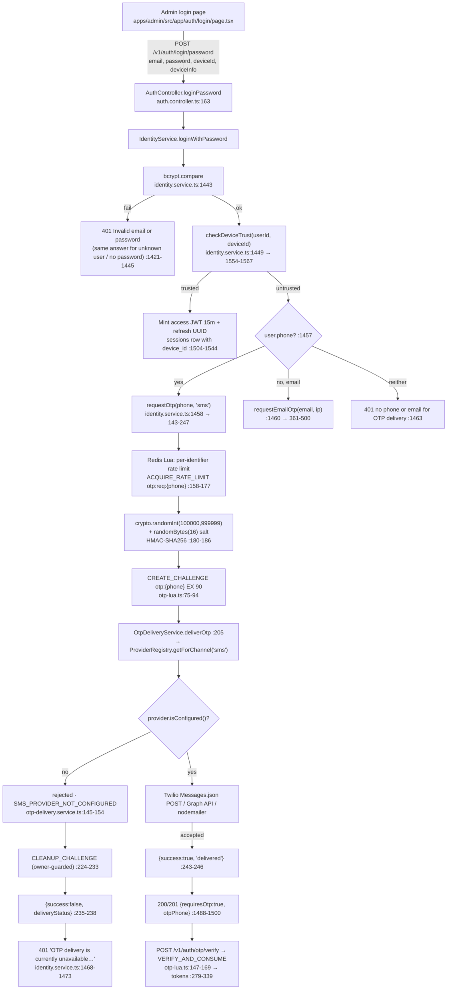

# OTP Implementation Completeness Audit and Staging Activation Readiness

**Report version:** v1.0
**Date:** 2026-11-06
**Repository:** `nabeel2323/scs-platform`
**Code audited at:** `develop` = `02b59d43f4421b1317eea6493e79cf9ebe066eb7` (the merge commit of PR #106)
**Branch for this report:** `audit/otp-staging-readiness-2026-11-06`
**Scope:** Audit and readiness assessment only. No application code, environment variable, deployment setting, Render/Vercel configuration, database data, migration, seed, credential or OTP message was created, changed or sent during this work. Every infrastructure action performed was an HTTP `GET` against a public health endpoint.

---

## 0. Method and evidence classes

Each statement is tagged with how it was established:

| Tag | Meaning |
|---|---|
| `[CODE]` | Read directly from source at `02b59d4`; `file:line` given. |
| `[TEST]` | A test was executed locally in this session; command and result in §11. |
| `[CI]` | Executed by hosted GitHub Actions on `develop`; run/job ids in §11. |
| `[LIVE]` | Observed from the running staging service by a read-only `GET` in this session. |
| `[DOC]` | Asserted by an earlier project document; date and caveats given, never treated as runtime proof. |
| `[NV]` | Not verifiable with the access available — stated rather than assumed. |
| `[INF]` | Inference from code plus observed behaviour; the inference chain is spelled out. |

Two ground rules were enforced throughout. First, a variable existing in `.env.example`, or a provider class existing in source, is never treated as proof that delivery works or that staging is configured. Second, no secret value, OTP code, phone number, email address, hash or token is reproduced anywhere in this report; where presence matters, only the name is given.

---

## 1. Executive summary

**Overall assessment: *implemented but partially incomplete — delivery integration is code-complete and unconfigured; authentication flow is complete and deliberately fail-closed*.** There are no missing OTP components. What is missing is provider credentials in the staging runtime, plus one operational setting (`TRUST_PROXY`) that must be corrected at the same time, and one provider-independent design gap (no delivery-receipt verification) that limits how strongly "delivered" can ever be claimed.

Specifically:

1. **OTP generation, storage, expiry, verification, attempt limits, delivery dispatch, trusted-device logic, session issuance and audit logging are all implemented** `[CODE]` — see §3 for the file-by-file inventory. This is not a skeleton: the challenge is HMAC-SHA256 keyed, stored only in Redis with a TTL, consumed atomically inside a Lua script, and bounded by per-identifier attempt limits.
2. **Three real delivery providers exist in code** — Twilio SMS, WhatsApp (Meta Cloud API) and SMTP email `[CODE]` §4. Each makes a genuine outbound HTTPS/SMTP call. The mock provider is double-gated and cannot be enabled in staging.
3. **The staging message the administrator sees is generated by the API, not the frontend.** The string exists exactly once, at `apps/api/src/modules/identity/identity.service.ts:1471`, and the admin app renders the backend `detail` verbatim (`apps/admin/src/lib/auth.ts:322` → `apps/admin/src/app/auth/login/page.tsx:83`). No i18n resource or feature flag is involved.
4. **Its meaning is precise and it is not informational.** It is emitted only when a correct email+password login comes from an untrusted device *and* the OTP provider reported a *definite* rejection (`identity.service.ts:1468-1473`). Therefore staging is currently **blocking** password logins from new devices. `[INF]`
5. **Password login depends on OTP delivery only when the device is not already trusted.** Email+password succeeds without any message being sent when the `deviceId` has an existing session for that user within 30 days (`identity.service.ts:1449`, `1504-1544`, `1554-1567`). On any other device, OTP delivery is a hard prerequisite.
6. **No database migration is required** to enable OTP `[CODE]` §3.4/§9. OTP challenges live only in Redis; the schema needed (sessions.device_id, feature_flags, account_link_log, audit_logs) already exists in migrations 0001/0002/0014/0064/0065.
7. **Redis is up in staging** — verified live, not inferred (`/v1/readyz` → `database: up, redis: up`, §8 of the evidence in §11.3). No queue or worker participates in OTP delivery; dispatch is synchronous inside the request (`identity.service.ts:205`, `459`, `468`).
8. **Provider credentials in staging could not be verified** `[NV]` — the Render dashboard host is unreachable from this workstation and no Render API token exists locally. However the observed staging message itself proves a *definite delivery rejection*, i.e. that at least one provider path is either unconfigured or rejecting (`§7.7`).
9. **Four security findings are material enough to fix before or alongside activation**, and one of them (`TRUST_PROXY` unset behind Render) would degrade the *whole* staging OTP feature to a single shared 20-requests-per-minute bucket for all users combined `[CODE]` §8.
10. **A user-visible defect will make activation look like failure** if it is not fixed or worked around: the admin Phone-OTP tab discards the API's `success:false` result and advances to the code-entry step anyway (`apps/admin/src/app/auth/login/page.tsx:95-96`), so an operator will wait for a code that was never sent.

---

## 2. Architecture map

### 2.1 Lifecycle



### 2.2 The four execution planes

| Plane | What runs | Evidence |
|---|---|---|
| Frontend | Admin: Password tab + Phone OTP tab (request/verify stages). Web: three tabs (`password`, `otp`, `email-otp`) with SMS/WhatsApp radios. | `apps/admin/src/app/auth/login/page.tsx:172-185`, `apps/web/src/app/auth/login/page.tsx:218-249`, `:347-377` `[CODE]` |
| API | NestJS, URI-versioned at `/v1` (no global prefix). All OTP logic in `IdentityService`; dispatch in `OtpDeliveryService`; providers in `notifications/providers`. | `apps/api/src/main.ts:111-114`, `apps/api/src/modules/identity/auth.controller.ts:27` `[CODE]` |
| State | Redis holds challenges + counters (90 s / 300 s TTL). Postgres holds users, sessions (device trust), audit logs, feature flags. **No OTP row exists in Postgres.** | `identity.service.ts:192`, `437`; `otp-lua.ts:91`; zero `otp` matches across all 65 migration SQL files `[CODE]` |
| Background | **None for OTP.** Delivery is awaited synchronously before the HTTP response. No BullMQ/AMQP/Kafka anywhere. The compose `worker` service runs the P13 return-expiration job, not notifications. | `identity.service.ts:205`, `459`, `468`; `infra/docker-compose.prod.yml:145-167` `[CODE]` |

---

## 3. Implementation inventory

### 3.1 Frontend (`[CODE]`)

| File | Role |
|---|---|
| `apps/admin/src/app/auth/login/page.tsx` | Admin login. Tabs `:172-186`; `handlePasswordLogin :58`, `handleRequestOtp :89`, `handleVerifyOtp :112`; error surface `:188-202`; rate-limit countdown `:204-223`. |
| `apps/admin/src/lib/auth.ts` | `loginPassword :300-342` (posts `deviceId`, `X-Device-Id`, maps `requiresOtp`), `requestOtp :168-179`, `verifyOtp :181-205`, rate-limit header parsing `:58-70`, session TTL 15 min `:201`. |
| `apps/web/src/app/auth/login/page.tsx` | Buyer login; **channel-aware** delivery-status mapping at `:122-136`, own string at `:132`, SMS/WhatsApp radios `:347-377`, resend-as-channel-toggle `:436-456`. |
| `apps/web/src/lib/auth.ts` | Endpoint clients: `:401` device-check, `:419-433` password, `:246-249` OTP request, `:263-274` verify, `:550-585` email OTP. |
| `apps/web/src/lib/device-id.ts` | Client-generated UUID persisted in `localStorage` (`:7`, `:18-23`) — the trusted-device credential. |
| `packages/contracts/src/index.ts` | Response shapes, e.g. `:85` login-password, `:97-99` device-check. |

Not found, after explicit search: any i18n/resource bundle containing the staging string; any capability/availability endpoint (`/config`, `/features`, `/capabilities`) in either Next app; any resend route; any client-side OTP expiry countdown.

### 3.2 Backend (`[CODE]`)

| File | What it owns |
|---|---|
| `apps/api/src/modules/identity/auth.controller.ts` | All auth routes (`:57` otp/request, `:64` otp/verify, `:79`/`:93` email variants, `:112-135` link/unlink, `:142-152` refresh/logout/switch-org, `:163` login/password, `:177` login/device-check), email kill-switch `:52-55`, 250 ms timing floor `:25`, `35-44`. |
| `apps/api/src/modules/identity/identity.service.ts` | Constants `:72-90`; HMAC secret `:110`, `124-127`; `requestOtp :143-247`; `verifyOtp :279-339`; `requestEmailOtp :361-500`; `consumeOtpChallenge :528-629`; `consumeEmailChallenge :637-650`; `consumePhoneChallenge :661-674`; `verifyEmailOtp :696-751`; `loginWithPassword` (password → trust → OTP) `:1401-1544`; `checkDeviceTrust :1554-1567`; `checkDeviceLogin :1717-1741`; `isEmailOtpEnabled :2032-2043`; `hashToken :2045-2047`. |
| `apps/api/src/common/redis/otp-lua.ts` | `ACQUIRE_RATE_LIMIT :29`, `CREATE_CHALLENGE :75-94`, `CLEANUP_CHALLENGE :106-123`, `VERIFY_AND_CONSUME :147-169`, plus the documented non-constant-time note `:125-136`. |
| `apps/api/src/modules/notifications/otp-delivery.service.ts` | `deliverOtp :57-71`, `deliverEmailOtp :81-94`, `deliverChallenge :123-182` (unconfigured → `<CHANNEL>_PROVIDER_NOT_CONFIGURED`, thrown error → `DELIVERY_ERROR`/`unknown`). |
| `apps/api/src/modules/notifications/provider-registry.service.ts` | Manual construction `:48-58`, mock fail-closed gate `:64-80`, channel lookup `:88-94`, availability helpers `:119-140`. |
| `apps/api/src/modules/notifications/providers/*.ts` | `twilio-sms.provider.ts`, `whatsapp.provider.ts`, `smtp-email.provider.ts`, `mock.provider.ts`, `provider.config.ts`, `provider.interface.ts`. |
| `apps/api/src/config/env-gate.ts` | Startup gates: JWT `:49-120`, OTP HMAC `:130-175`, DB/Redis `:199-240`, alert sink `:265-331`, `resolveTrustProxy :357-390`. |
| `apps/api/src/main.ts` | Boot order: `assertJwtConfig() :14`, `assertOtpHmacConfig() :20`, `assertProductionConfig() :26`, Nest create `:32`, `resolveTrustProxy :42`, CORS `:57`, versioning `:111-114`. |
| `apps/api/src/common/services/rate-limit.service.ts` | `checkAndIncrement :99-115` — the password-login per-email counter (non-atomic; see §8 S-10). |
| `apps/api/src/health.controller.ts` | `/v1/healthz :19-23`, `/v1/readyz :25-65` (DB + Redis ping). |

### 3.3 Endpoints and the exact condition behind the staging message

`[CODE]` The string appears once in the repository's source:

```
identity.service.ts:1468  if (!otpResult.success && !otpResult.possiblyDelivered) {
identity.service.ts:1471    'OTP delivery is currently unavailable. Please contact support or use a trusted device.',
```

`!success && !possiblyDelivered` is true only when the delivery result carried `deliveryOutcome: 'rejected'` — that is: provider not configured (`otp-delivery.service.ts:145-154`), or the provider returned a definite rejection (Twilio 400/401/403, SMTP auth/refusal, Meta 4xx), or an unknown channel. Timeout/exception paths set `possiblyDelivered: true` (`identity.service.ts:211-221`) and take the other branch. The frontend contributes nothing to the decision: `apps/admin/src/lib/auth.ts:322` forwards `error.detail`, and `apps/admin/src/app/auth/login/page.tsx:83` prints it.

### 3.4 Database and migrations (`[CODE]`)

| Object | Created in | Needed by OTP flow? |
|---|---|---|
| `users` | `infra/drizzle/migrations/0001_identity.sql:11` (+ `password_hash` `0014_dual_auth.sql:8-10`, phone-nullable `0064_email_identity.sql:86`) | Yes — identity + password. |
| `sessions` (`token_hash :126`, `device_id :128`, `revoked_at :131`) | `0001_identity.sql:72`; `device_id` + index `0014_dual_auth.sql:13-15` | **Yes — this table *is* the trusted-device store.** |
| `feature_flags` | `0002_platform.sql:46` (cols extended `0063_…:175-176`) | Only for **email** OTP. |
| `auth.email_otp.enabled` row | `0064_email_identity.sql:182-184`, seeded `false` | Gates the 6 email routes (404 when off). |
| `audit_logs` | `0002_platform.sql:5` | Records `auth.otp_requested`, `auth.otp_challenge`, `auth.login`. |
| `credential_audit_log` / `account_link_log` | `0014_dual_auth.sql:18`, `0064_email_identity.sql:161`, hash column `0065_hmac_identifier_hash.sql:23-32` | Adjacent; note §8 S-12. |
| OTP challenge table | **does not exist** — zero `otp` matches in all 65 migration files | Redis only. |

Highest migration: `0065_hmac_identifier_hash.sql`. Startup does **not** migrate outside `development`/`test` (`apps/api/src/common/database/database.service.ts:54-57`); the operator command is `pnpm --filter @scs/api db:migrate` (`apps/api/package.json:19`) → `apps/api/infra/drizzle/migrate-pg.ts` (advisory lock `:54`, `_migration_log` ledger `:59-69`, per-file BEGIN/apply/ledger/COMMIT `:97-100`, `--dry-run` `:14`).

---

## 4. Provider inventory

| Provider | Channel | Implementation | Configuration (names only) | Credentials type | Sender identity | External setup | Runtime dependency | Staging readiness |
|---|---|---|---|---|---|---|---|---|
| `TwilioSmsProvider` (`providers/twilio-sms.provider.ts:35`) | SMS | **Complete** — real HTTPS `POST https://api.twilio.com/2010-04-01/Accounts/{sid}/Messages.json` (`:30`, `:82`, `:100-108`), Basic auth, 10 s timeout (`:97`), status mapping `:122-137` | `TWILIO_ACCOUNT_SID`, `TWILIO_AUTH_TOKEN`, `TWILIO_FROM_NUMBER` (`provider.config.ts:79-83`) | Account SID + API token (secret) | A Twilio-purchased SMS-capable number in E.164 | Twilio account with live credit; number purchase; (US A2P 10DLC registration where applicable — outside the repo, `[NV]`) | None beyond Redis-reachable API process (delivery is synchronous) | **CONFIGURATION REQUIRED** |
| `WhatsAppProvider` (`providers/whatsapp.provider.ts:37`) | WhatsApp | **Complete** — `POST https://graph.facebook.com/{ver}/{phoneNumberId}/messages` (`:84`, `:117-125`) using a pre-approved template, one body parameter = OTP, language hardcoded `en` (`:88-110`) | `WHATSAPP_ACCESS_TOKEN`, `WHATSAPP_PHONE_NUMBER_ID`, `WHATSAPP_BUSINESS_ACCOUNT_ID`, optional `WHATSAPP_TEMPLATE_NAME` (default `authentication`), `WHATSAPP_API_VERSION` (default `v18.0`, malformed → warn+default `provider.config.ts:117-128`) | Permanent/short-lived Graph token | Verified WhatsApp Business phone number | Meta Business verification + **template approval (24–48 h per `[DOC]` `docs/production/SCS-OTP-WHATSAPP-SMS-INTEGRATION-REPORT.md:200-205`)**; `WHATSAPP_BUSINESS_ACCOUNT_ID` is required by `isConfigured()` but never referenced in the request body (`:88-110`); the requirement itself lives in `provider.config.ts:130` | as above | **CONFIGURATION REQUIRED + external approval** |
| `SmtpEmailProvider` (`providers/smtp-email.provider.ts:92`) | Email | **Complete** — `nodemailer.createTransport :100-110`, `sendMail :145-154`, HTML+text bodies, error taxonomy `:173-250` | `SMTP_HOST`, `SMTP_PORT` (default 587), `SMTP_SECURE` (default false), `SMTP_USER`, `SMTP_PASSWORD`, `SMTP_FROM` (`provider.config.ts:156-165`) | SMTP username/password (optional → anonymous relay `:163-171`) | From-address/domain | Provider account + **SPF/DKIM/DMARC on the sending domain** (`[DOC]` `OTP-S1.39-STAGING-READINESS-ASSESSMENT.md:101-112`) | Requires DB flag `auth.email_otp.enabled = true` for the email **routes** (`identity.service.ts:49`, `2032-2043`) | **CONFIGURATION REQUIRED** (and see §7 note on the password-login fallback) |
| `MockOtpProvider` (`providers/mock.provider.ts:31`) | internal `mock` | Complete for dev/test only | `OTP_MOCK_ENABLED=true` | none | none | Refused when `NODE_ENV` is production-like (`provider-registry.service.ts:64-80`; `mock.provider.ts:43-49` + `env-gate.ts:32-35`) | none | **NOT AVAILABLE in staging — by design** |
| Push/FCM, secondary SMS, WhatsApp-notifications (different subsystem) | — | **Placeholder** — `notifications.service.ts`: `sendWhatsApp :343-349`, `smsProviderPrimary :353-357`, `smsProviderFallback :359-362` ("For now, simulate success"), `fcmSend :364-368`; rows are marked `SENT` without sending | `FCM_*`, `SMS_PRIMARY_PROVIDER`, `SMS_SECONDARY_PROVIDER` (all dead, §5.3) | — | — — | Meta/FCM accounts | none | **IMPLEMENTATION REQUIRED** (not on the OTP path) |

Two structural facts about the OTP-path providers `[CODE]`: they are **not** Nest DI providers — they are `new`-ed inside `provider-registry.service.ts:48-50`, so they cannot be swapped or inspected through the DI container; and **none** of them verifies actual handset/mailbox delivery — a successful result means "the provider API accepted the request" (`provider.interface.ts:49-51`, `twilio-sms.provider.ts:159-164`), with no `sid` status polling and no inbound webhook anywhere in the repo.

---

## 5. Configuration checklist

### 5.1 Required before OTP can work at all

| Variable | Used by | Required? | Purpose | Behaviour when absent | Staging status |
|---|---|---|---|---|---|
| `OTP_HMAC_SECRET` | `env-gate.ts:174`, `identity.service.ts:126` | Startup + generation + verification | HMAC key for challenge digests **and** persisted identifier hashes | Production-like `NODE_ENV`: **boot throws** (`env-gate.ts:136-154`) for missing / committed-placeholder / <32 chars. Dev/test: silent dev fallback | **VERIFIED (inference)** `[LIVE]`+`[INF]` — the service answers `/v1/readyz` today, which is only possible if the boot gate passed under a production-like `NODE_ENV` |
| `JWT_ACCESS_SECRET` | `env-gate.ts:90`, `identity.module.ts:22` | Startup | Signs access tokens | Same gate shape; boot throws | **VERIFIED (inference)** as above |
| `DATABASE_URL` | `database.service.ts:35` | Startup | users/sessions/audit | Prod-like: throws. `readyz` currently reports `database: up` | **VERIFIED** `[LIVE]` |
| `REDIS_URL` | `redis.service.ts:15` | Startup | challenges, counters, throttler storage | Prod-like: throws; boot also awaits connect (`:27`) → fail-closed. `readyz` reports `redis: up` | **VERIFIED** `[LIVE]` |
| `NODE_ENV` | 11 sites incl. `env-gate.ts:32-35`, `provider-registry.service.ts:64` | Effectfully yes | selects fail-closed vs dev fallback; gates mock provider | **Unset is treated as `development` by the secret gates (fail-open) but as non-dev by the mock gate (fail-closed)** — see §8 S-4 | **NOT VERIFIABLE** `[NV]`; a dev-fallback boot would be a security incident, so the owner should confirm it is `production` |
| `TRUST_PROXY` | `main.ts:42` | Required for correct rate limiting behind Render | client-IP resolution | Unset → `false` → every client appears as the proxy IP and shares one bucket; malformed → **throws after connections open** | **CONFIGURATION REQUIRED** `[CODE]`+`[NV]` (§8 S-4) |

### 5.2 Required for delivery (per provider)

`TWILIO_ACCOUNT_SID` / `TWILIO_AUTH_TOKEN` / `TWILIO_FROM_NUMBER` → else `SMS_PROVIDER_NOT_CONFIGURED` at send time and **no boot error** (`provider.config.ts:83`, `otp-delivery.service.ts:145-154`).
`WHATSAPP_ACCESS_TOKEN` / `WHATSAPP_PHONE_NUMBER_ID` / `WHATSAPP_BUSINESS_ACCOUNT_ID` (+ optional `WHATSAPP_TEMPLATE_NAME`, `WHATSAPP_API_VERSION`) → else `WHATSAPP_PROVIDER_NOT_CONFIGURED`.
`SMTP_HOST` / `SMTP_FROM` (required) + `SMTP_PORT` / `SMTP_SECURE` / `SMTP_USER` / `SMTP_PASSWORD` (optional-by-design) → else `EMAIL_PROVIDER_NOT_CONFIGURED`.
`OTP_MOCK_ENABLED` → must stay absent/`false` in staging (it is refused anyway, §4).

Important design fact `[CODE]`: `hasAnyProvider()` exists (`provider.config.ts:202`) but is **never called at boot**. An environment with zero configured providers starts, reports `healthz`/`readyz` green, and fails only per request. That is exactly the shape of the current staging symptom, and it is why no monitoring signal today would have caught it.

### 5.3 Declared but not read by any code (do not configure these expecting an effect)

`OTP_LENGTH`, `OTP_TTL`, `OTP_MAX_ATTEMPTS`, `OTP_PROVIDER`, `JWT_REFRESH_SECRET`, `JWT_ACCESS_TTL`, `JWT_REFRESH_TTL`, `FLAG_AUTH_EMAIL_OTP`, `SMS_PRIMARY_PROVIDER`, `SMS_SECONDARY_PROVIDER`, `FCM_PROJECT_ID`, `FCM_CLIENT_EMAIL`, `FCM_PRIVATE_KEY`, `DATABASE_POOL_MIN`, `S3_CDN_URL`, `MAPBOX_ACCESS_TOKEN`, `OTEL_*`, `FLAGS_*`.

Real values are hardcoded instead: 6-digit code (`identity.service.ts:180`, `428`), TTL 90 s phone / 300 s email (`:72`, `:75`), 5 requests per 900 s (`:78`), 10 verify failures (`:81`), 20 requests/IP/60 s and 40 verify/IP/60 s (`app.module.ts:52-64`), access TTL 15 m (`identity.module.ts:24`), session/refresh 30 d (`identity.service.ts:325`). Email-OTP enablement comes from the **`feature_flags` table**, never from an env var (`identity.service.ts:2035`). The Zod schema in `packages/env/src/index.ts` (`ApiEnvSchema`, `validateEnv :71-81`) is dead code for the API — nothing imports it, and it lists none of these variables.

### 5.4 Frontend variables

`NEXT_PUBLIC_API_URL` only (`apps/admin/src/lib/auth.ts:21`, `apps/web/src/lib/auth.ts:26`), plus `NEXT_PUBLIC_WS_URL`, `NEXT_PUBLIC_CDN_URL`. No OTP-specific frontend variable exists, and no frontend behaviour can switch OTP on or off. `[CODE]`

---

## 6. External account requirements

| Requirement | Provider | Status |
|---|---|---|
| Twilio account, live balance, an SMS-capable number in E.164 to use as `TWILIO_FROM_NUMBER` | SMS | `[NV]` — cannot be inspected from this workstation |
| Regulatory sender registration for the destination country (e.g. US A2P 10DLC, or a verified local sender ID) | SMS | `[NV]`; a `[DOC]` note flags a +963 sender-ID/Meta restriction as unresolved (`SCS-OTP-WHATSAPP-SMS-INTEGRATION-REPORT.md:58`, `:310-311`) |
| Meta Business Verification, a WhatsApp-enabled number, an approved `authentication` template in `en` | WhatsApp | `[NV]` |
| Transactional email account + SPF/DKIM/DMARC on the sending domain, and a mailbox for the test address | Email | `[NV]` |
| Redis reachable from the API (already true) | infra | **VERIFIED** `[LIVE]` |
| A phone number the owner controls for validation, or an address on a whitelisted domain | test harness | Owner must supply; no test recipient exists in the repo (searched `sandbox`, `test number`, `example.org` fixtures) `[NV]` |

---

## 7. Authentication behaviour

### 7.1 The three paths, as executed

`[CODE]` `loginWithPassword` (`identity.service.ts:1401-1544`) in order: per-email counter 5/900 s (`:1401-1414`) → user lookup (`:1417`) → identical answer for unknown user / no password set / wrong password (`:1421-1446`, bcrypt-compared against a fixed dummy hash for timing) → `checkDeviceTrust` (`:1449`) → **trusted:** mint access JWT + refresh UUID, insert `sessions` row with `device_id`, return tokens (`:1504-1544`) · **untrusted:** request OTP on phone, else email, else hard error (`:1457-1466`) → if delivery definitively failed, throw (`:1468-1473`) → otherwise audit `auth.otp_challenge` (`:1478-1486`) and return `requiresOtp: true` with **empty** tokens (`:1488-1500`).

### 7.2 Explicit answers

1. **Can an administrator log in with email/password when OTP delivery is unavailable?** **Only from a trusted device.** From any other device the login is refused at `:1468-1473` before any token exists. There is no "continue anyway" branch, and no admin-only bypass — the auth controller contains no role guard at all (`auth.controller.ts:57-177`).
2. **Does an untrusted device require OTP?** Yes, unconditionally, and delivery must at least be *attempted with a non-rejected outcome* (`possiblyDelivered` from a timeout still proceeds).
3. **Can an administrator authenticate from a previously trusted device?** Yes: a `sessions` row for `(user_id, device_id)` created within 30 days (`:1554-1567`). The browser's `localStorage['scs_device_id']` (`apps/web/src/lib/device-id.ts:7`, `18-23`) is what makes a device "previous".
4. **Is trusted-device handling fully implemented?** Mechanically yes (persist, check, revoke, list, refresh carries `deviceId` forward `:797`). **But it is weaker than it looks**: `checkDeviceTrust` deliberately ignores `revoked_at` (`:1549-1552`) and the device credential is an unauthenticated client-supplied UUID — see §8 S-1.
5. **Does OTP delivery failure prevent password authentication, or only the second step?** It prevents the **whole** authentication on an untrusted device. The password check succeeds first, then the request is aborted with 401 and no tokens — fail-closed by design.
6. **Is the staging warning informational?** **No.** It means password logins from devices with no session in the last 30 days are currently blocked. A device that is already trusted will log in without seeing it. `[CODE]`+`[INF]`
7. **What exact backend condition produces it?** `deliveryOutcome === 'rejected'` for the account's preferred channel — i.e. `SMS_PROVIDER_NOT_CONFIGURED` / `WHATSAPP_PROVIDER_NOT_CONFIGURED` / `EMAIL_PROVIDER_NOT_CONFIGURED` (`otp-delivery.service.ts:145-154`) **or** a provider 4xx rejection (`twilio-sms.provider.ts:122-137`, `smtp-email.provider.ts:173-250`, `whatsapp.provider.ts`). The frontend message does not distinguish the two, and the distinguishing signal is the API log line (`otp-delivery.service.ts:146` "Provider for channel 'sms' is not configured" vs `:164` "OTP delivery failed … <reason>") `[CODE]` — which is only visible in Render logs `[NV]`.

### 7.3 Note on the email-OTP flag

The `auth.email_otp.enabled` flag gates only the six **routes** (`auth.controller.ts:52-55`, applied at `:87`, `:102`, `:114`, `:121`, `:128`, `:135`). The **in-service fallback** at `identity.service.ts:1460` calls `requestEmailOtp` directly and therefore bypasses the flag: a phone-less account can still be sent an email OTP by password login once SMTP is configured, even while the flag is `false`. Conversely, the admin app has no email-OTP tab, so it could not deliver that code interactively — the fallback would fail silently from the UI's point of view. `[CODE]` (relevant to §10 step 9.)

---

## 8. Security findings

Critical / blocking-adjacent, in risk order.

**S-1 — Trusted-device factor is a client-supplied identifier, and revocation does not remove trust. (High)** `checkDeviceTrust` (`identity.service.ts:1554-1567`) matches only `(userId, deviceId)` and a 30-day `created_at`, ignoring `revoked_at` by explicit comment (`:1549-1552`), and `revokeSessionsByDevice` (`:1767-1777`) revokes tokens but not trust. `deviceId` is an unauthenticated UUID held in `localStorage`, echoed in the request body and `X-Device-Id` (`apps/admin/src/lib/auth.ts:305-316`). Consequence: **a stolen password plus a copied/exfiltrated `deviceId` yields a full session with no OTP at all.** Mitigations present: 122-bit unguessable UUID, 5/900 s per-email password cap. Mitigations absent: server-side binding of the device credential, step-up on new IP/UA, any test for this scenario. Fix direction (not applied): require a server-issued, HttpOnly device credential, or re-OTP when the trusted session's fingerprint changes.

**S-2 — `POST /v1/auth/login/device-check` is unauthenticated, unthrottled, and returns `hasPassword` + `canAutoLogin` (`auth.controller.ts:177-180`, `identity.service.ts:1717-1741`). (High)** No `ThrottlerGuard` is registered globally (`grep APP_GUARD apps/api/src/app.module.ts` → none) and this route carries no `@Throttle`. It is also the one auth route that reads the **raw** email (`:1722`, no `normalizeEmail`), unlike every other path. For an arbitrary address the endpoint answers whether a password exists and, for a guessed `(email, deviceId)` pair, whether that device is trusted — a free enumeration and device-pair oracle. Fix direction: add a throttle profile, normalize the identifier, and collapse the response to a single indistinguishable field.

**S-3 — Phone OTP verification auto-creates accounts (`identity.service.ts:287-295`, `705-713`). (Medium)** Any SMS-reachable number that completes OTP obtains a user. This is a deliberate product choice and removes the enumeration oracle, but combined with real Twilio credentials it turns staging into an account factory; keep it out of production scope or gate it.

**S-4 — `TRUST_PROXY` unset behind Render collapses every client into one rate-limit bucket. (Medium, operationally severe once OTP is live)** With `trust proxy` false, `req.ip` is the proxy peer for *all* users, so the named throttlers — `otp-request` 20/60 s and `otp-verify` 40/60 s (`app.module.ts:52-64`) — become **global** staging-wide limits, and the email per-IP Lua limit (20/60 s, `identity.service.ts:401-425`) is shared too. Enabling OTP without setting `TRUST_PROXY` therefore creates a self-inflicted availability outage: two users can lock out the rest. The safe value on Render is a hop count (`1`) or explicit proxy CIDRs; `true` is rejected as a wildcard-equivalent by design (`env-gate.ts:362-364`, `:377-383`). `[CODE]`

**S-5 — Password-login limiter is not atomic (`common/services/rate-limit.service.ts:99-115`, GET-then-INCR). (Low-Medium)** Concurrency can overshoot the 5/900 s cap. The OTP-path Lua limiter is atomic; this one is not.

**S-6 — Verify-attempt cap is per identifier, not per challenge (`identity.service.ts:594-611`, `667`, `643`). (Low, by design)** 10 failures per 900 s against a 10⁶ code space with a 90 s TTL ⇒ p ≈ 10⁻⁵ per challenge, 5×10⁻⁵ per window. A wrong code never consumes the challenge (`otp-lua.ts:162-164`), and superseding a challenge does not reset the counter. Acceptable, but worth stating: the entropy budget is spent per *phone/email*, so one attacker targeting many numbers gets 10 tries each.

**S-7 — Dead replay branch (`otp-lua.ts:88`, `:158-160`; `identity.service.ts:592-593`). (Low)** `co` is written only as `false` at creation and nothing anywhere sets it `true`, so status `-2` "already used" is unreachable; replay protection in practice comes solely from `DEL` on success (`otp-lua.ts:167`). Not a vulnerability — a misleading invariant and dead code, untested.

**S-8 — Non-constant-time digest comparison inside Redis. (Informational, documented)** `challenge.hs ~= providedHash` (`otp-lua.ts:162`). The code itself refuses the "constant-time" label with reasoning (`:125-136`): the compared value is an HMAC digest of a short-lived 6-digit code, executed server-side, bounded by S-6. Assessment: acceptable risk, correctly documented; no test asserts the timing claim.

**S-9 — PII placement.** Redis keys carry the raw E.164 phone / normalized email (`identity.service.ts:192`, `437`, `665`) — PII at rest in the cache. `auth.login` OTP audit writes the **cleartext** phone in metadata (`:334`) while the email paths write an HMAC identifier (`:746`, `:1483`, `:1539`) — asymmetric. And `requiresOtp` returns the **full** phone to a password-only, unverified session (`:1488-1499`, acknowledged in the comment). OTP values themselves are never logged (masked subjects at `:153`, `241`, `503`; `otp-redaction.spec.ts` `[TEST]`).

**S-10 — No delivery proof.** Every provider reports `accepted` on an API 2xx (`provider.interface.ts:49-51`) with no receipt polling or webhook. "OTP delivered" can therefore never be asserted about staging — only "the provider accepted the send request". This constrains §10's validation step and should be reflected in wording.

**S-11 — Providers are not DI-managed (`provider-registry.service.ts:48-50`). (Low)** No swap for testing or health reporting; `OtpDeliveryService` even self-constructs a registry when injected nothing (`otp-delivery.service.ts:38-43`).

**S-12 — `OTP_HMAC_SECRET` is dual-purpose with no key versioning. (Medium, operational risk)** It keys ephemeral challenges *and* the persisted `account_link_log.identifier_hash` (`identity.service.ts:1838`, `1903`, `1970`, `2018`; `identity.schema.ts:166`). The `v2:` prefix denotes algorithm version, not key version. Rotating the secret silently de-correlates historical rows — so the "rotation is free because challenges expire in 90 s" claim in older documents (`[DOC]` `SCS-OTP-S1.3-SECOND-INDEPENDENT-AUDIT-REPORT.md:221`) holds only for Redis.

**S-13 — `NODE_ENV` absent is fail-open for the secret gates (`env-gate.ts:32-35`) while fail-closed for the mock gate (`provider-registry.service.ts:64-68`). (Medium)** A deployment that forgets `NODE_ENV` boots on the committed dev HMAC secret with dev DB/Redis defaults. Confirm `NODE_ENV` is explicitly set in Render; this is the one configuration item whose absence this audit could not detect from outside.

No security control was weakened during this audit, and none was fixed — findings are recorded for a separate remediation task.

---

## 9. Staging readiness matrix

| Item | Status | Basis |
|---|---|---|
| OTP generation (CSPRNG, 6-digit, salted HMAC) | **VERIFIED** | `identity.service.ts:180-186`; 484 unit tests pass §11.1 `[CODE]`+`[TEST]` |
| OTP storage/expiry/consumption in Redis | **VERIFIED** (code+unit); runtime Lua atomicity verified only in hosted CI | `otp-lua.ts:75-169`; `[CI]` integration job on develop §11.2 |
| Attempt limits, resend/rate limits | **VERIFIED** (code+unit) | `identity.service.ts:158-177`, `594-611`; `app.module.ts:52-64` `[TEST]` |
| Verification → session issuance | **VERIFIED** | `identity.service.ts:279-339`, `1504-1544` `[TEST]` |
| Audit logging of OTP events | **VERIFIED** (with S-9 caveats) | `:328-337`, `1478-1486`; `audit-log.middleware.ts:34`, `89-113` |
| Database schema for OTP flows | **VERIFIED** — no migration required | `0001`, `0002`, `0014:13-15`, `0064:182-184`, `0065` `[CODE]` |
| Redis availability in staging | **VERIFIED** `[LIVE]` | `GET /v1/readyz` → `redis: up`, 2026-11-06 |
| API bootable in staging (JWT + OTP gates satisfied) | **VERIFIED (inference)** `[LIVE]`+`[INF]` | service responds today; `main.ts:14-20` gates precede listen |
| Trusted-device behaviour | **IMPLEMENTATION COMPLETE, SECURITY GAP** (S-1) | `identity.service.ts:1554-1567` |
| Device-check hardening | **IMPLEMENTATION REQUIRED** (S-2) | `auth.controller.ts:177-180` |
| Proxy trust for correct throttling | **CONFIGURATION REQUIRED** (S-4) | `main.ts:42`, `app.module.ts:52-64` |
| SMS delivery (Twilio) | **CONFIGURATION REQUIRED** | `provider.config.ts:79-83`; message symptom ⇒ currently unusconfigured-or-rejecting `[INF]` |
| WhatsApp delivery | **CONFIGURATION REQUIRED + external approval** | `:110-130`; Meta template `[NV]` |
| Email delivery (SMTP) | **CONFIGURATION REQUIRED** (+ `feature_flags` row for the routes) | `:156-165`; `identity.service.ts:2032-2043` |
| Mock provider in staging | **BLOCKED** (intentional security boundary) | `provider-registry.service.ts:64-80` |
| Provider credentials present in Render | **NOT VERIFIABLE** `[NV]` | `cloud.render.com` unresolvable; `dashboard.render.com` session not authenticated; no local Render token |
| `NODE_ENV` value in Render | **NOT VERIFIABLE** `[NV]` (see S-13) | — |
| Whether the admin account has a phone (selects SMS vs email fallback) | **NOT VERIFIABLE** `[NV]` | would require reading user data — out of scope by instruction |
| Real message ever delivered to a handset/mailbox | **BLOCKED on evidence** — nothing in code, docs or CI proves it; several `[DOC]` records state it was never verified | `SCS-OTP-WHATSAPP-SMS-INTEGRATION-REPORT.md:576-577`; `SCS-OTP-S1.9-RUNTIME-AND-DELIVERY-READINESS-REPORT.md:302`, `:306`; `OTP-S1.33-STAGING-READINESS-REPORT.md:368`, `:377` |

Historical correction worth recording: an earlier document read a staging `201` from `/otp/request` as mock-provider behaviour (`[DOC]` `SCS-STAGING-SAFETY-AND-TEST-DATA-VERIFICATION.md:100-104`, 2026-10-22). That reading is invalid for current code — `OTP_PROVIDER` is not read by any code (§5.3), and a `2xx` with `success:false` is what an *unconfigured* provider returns today (`identity.service.ts:235-238`). A 2xx from that endpoint has never proved delivery.

---

## 10. Activation runbook (staging)

**Provider to activate first: Twilio SMS.** Basis `[CODE]`: it is the only channel the **admin** app can complete end-to-end — the admin UI has a Phone OTP tab and no email-OTP tab (`apps/admin/src/app/auth/login/page.tsx:179-185`), the password-login fallback prefers `user.phone` (`identity.service.ts:1457`), the default channel is `'sms'` (`:145`, `auth.controller.ts:61`), and unlike WhatsApp it needs no Meta template approval. Email/SMTP is the fallback for phone-less accounts and should follow, not lead. WhatsApp is last (external approval dependency).

Ordered steps. **Nothing in this list was executed in this session.**

1. **Owner confirms current config, read-only**, in Render → `scs-api-staging` → Environment: presence (not values) of `NODE_ENV`, `OTP_HMAC_SECRET`, `JWT_ACCESS_SECRET`, `DATABASE_URL`, `REDIS_URL`, `TRUST_PROXY`, and any `TWILIO_*`/`WHATSAPP_*`/`SMTP_*`. Expected today: everything present except the delivery variables. This closes the two `NOT VERIFIABLE` rows of §9.
2. **Fix proxy trust before enabling delivery:** set `TRUST_PROXY = 1` (single Render edge hop; CIDR list is the stricter alternative). Without it, OTP is globally capped at 20 requests/min for all users together (S-4). Confirm the boot did not throw — `resolveTrustProxy` runs after connections open (`main.ts:42`).
3. **Create the Twilio account and number** (owner): account SID, auth token, one SMS-capable number in E.164, and the destination-country sender registration (§6). Fund the account.
4. **Set exactly three variables in Render for `scs-api-staging`:** `TWILIO_ACCOUNT_SID`, `TWILIO_AUTH_TOKEN` (both as secrets), `TWILIO_FROM_NUMBER`. Do not add `OTP_PROVIDER`, `OTP_LENGTH`, `OTP_TTL` or `OTP_MAX_ATTEMPTS` — none is read (§5.3).
5. **No migration, no seed, no worker.** Migrations 0001/0002/0014/0064/0065 already provide everything (§3.4) and OTP lives only in Redis. Only if step 1/§9 shows `_migration_log` missing `0064` or `0065` (or `OTP_HMAC_SECRET` rotation is ever performed) run `pnpm --filter @scs/api db:migrate` against staging — the release pipeline's `Database Migration & Seed` job already does this on deploy, so treat a manual run as an exception. Redis must be running: it is (`[LIVE]`). No queue consumer is involved.
6. **Redeploy** so the process re-reads the environment (`ProviderRegistryService` resolves credentials in its constructor, `provider-registry.service.ts:45`, at DI time — a variable added after boot has no effect). A normal push to `develop` now does this automatically via the release pipeline, which was observed working on 2026-11-06 (§11.2); otherwise use Render's own redeploy.
7. **Verify the boot log line**, which is the cheapest unambiguous signal without sending anything: `provider.config.ts:86` logs "Twilio SMS provider is not configured (missing credentials)" vs `:88` "Twilio SMS provider is configured". Presence-only, never values.
8. **Validate delivery safely, once, with owner-controlled data.** Use a number the owner physically holds. Prefer the **Phone OTP tab in the admin app**, because that route returns `2xx` with `success`/`deliveryStatus` instead of throwing (`identity.service.ts:235-246`), and read the outcome in the API log rather than trusting the UI (see step 10). Expected log on success: `OTP delivered via sms to ***NNNN (challenge: …)` (`:241`, masked). **Note the ceiling from S-10:** the strongest claim available is "Twilio accepted the send" — confirm receipt on the handset personally, and treat provider-side `sid` polling as future work.
9. **Validate verification and trusted-device behaviour.** Verify the code at `POST /v1/auth/otp/verify` with the same `deviceId` (`auth.controller.ts:64`) → expect tokens and a `sessions` row. Then log out, log back in with email+password from the **same browser** and confirm **no OTP is requested** (`identity.service.ts:1449` true-path). Then repeat from a second browser/private window (fresh `deviceId`) and confirm an OTP is requested. Negative check: a wrong code should return "invalid" until 10 attempts, then `Too many invalid OTP attempts.` (`:594-611`) — the challenge itself is not deleted by lockout.
10. **Fix or work around the admin silent-success defect before calling activation complete.** `handleRequestOtp` ignores the result object and moves to the verify stage regardless (`apps/admin/src/app/auth/login/page.tsx:95-96`; contrast the web app's channel-aware branch at `apps/web/src/app/auth/login/page.tsx:122-136`). Until a small frontend change checks `success`/`deliveryStatus`, operators must read the API log — otherwise a failed send looks like a slow send. This is a code change, out of scope here.
11. **Optional, second channel:** if phone-less admin/service accounts must be served, configure `SMTP_HOST`, `SMTP_FROM` (+ port/user/password/secure) and set the DB row `auth.email_otp.enabled = true` — a **data change**, not a migration (`0064_email_identity.sql:180-184` documents exactly this UPDATE). Understand §7.3 first: the password-login fallback already ignores that flag, while the email routes and the admin UI do not.
12. **Rollback safely.** Remove/blank the three `TWILIO_*` variables and redeploy: the provider returns to `SMS_PROVIDER_NOT_CONFIGURED`, and password logins from untrusted devices return to the present fail-closed behaviour. Existing sessions and trusted devices are unaffected, and no data is rolled back. **Do not** rotate `OTP_HMAC_SECRET` as part of an OTP rollback — it would orphan `account_link_log` identifier hashes (S-12). Redis challenge keys expire by TTL and need no cleanup.

---

## 11. Test and evidence summary

### 11.1 Tests executed locally in this session (all at `02b59d4`)

| # | Command (run from the stated directory) | Result |
|---|---|---|
| 1 | `apps/api>` `pnpm exec vitest run src/__tests__/unit/identity src/__tests__/unit/config src/__tests__/unit/auth` | **21 files / 333 tests passed**, 19.81 s |
| 2 | `apps/api>` `pnpm exec vitest run src/__tests__/unit/config src/__tests__/unit/notifications src/__tests__/unit/common` | **13 files / 175 tests passed**, 6.10 s (overlaps run 1 on `unit/config`) |
| 3 | `apps/api>` `pnpm exec vitest run` over the union of `unit/identity unit/auth unit/config unit/notifications unit/common` | **33 files / 484 tests passed**, 0 failed |
| 4 | `apps/web>` `pnpm exec vitest run src/__tests__/auth-login-channel.test.tsx src/__tests__/email-otp-login.test.tsx` | **2 files / 24 tests passed**, 7.70 s |

Run 3 is the headline number: 484 assertions across the OTP-relevant API unit surface (generation/HMAC/redaction, concurrency and Lua-backed limits, email OTP lifecycle and error coverage, enumeration-shape, controller delegation and kill-switch/timing, IP throttling, provider classification incl. `*_NOT_CONFIGURED`, SMTP error taxonomy, mock fail-closed gating, `env-gate` semantics for `OTP_HMAC_SECRET`/`TRUST_PROXY`, Redis throttler fail-closed, proxy trust behaviour, token revocation).

Integration suites were **not** executed locally: Docker is unavailable on this workstation and starting it is an unrequested machine-level change. They are covered by hosted CI instead (§11.2). `apps/admin` was not run because it contains no auth/OTP test at all (only `management.test.tsx`, `shipops.test.tsx`).

### 11.2 Hosted CI on `develop` `[CI]`

Run **#432** — https://github.com/nabeel2323/scs-platform/actions/runs/42001570625 — `push` to `develop` at head `02b59d4`, **conclusion success**, 15 jobs.

| Job | Conclusion | id | Window (UTC) |
|---|---|---|---|
| Lint & Typecheck | success | 127157808336 | 09:20:33 → 09:22:03 |
| Mobile | success | 127157807965 | 09:20:33 → 09:21:29 |
| Integration Tests | success | 127158519287 | 09:22:05 → 09:31:35 (9 m 30 s, disposable PostGIS + Redis services) |
| Unit Tests + Coverage Gates | success | 127158519359 | 09:22:06 → 09:28:59 |
| Migration Full Apply | success | 127158519150 | 09:22:05 → 09:22:58 |
| Boundary Lint (E6) | success | 127158519232 | 09:22:05 → 09:22:33 |
| Build / Contract Spec / Container Build | success | 127162962981 / 127162963058 / 127162962901 | 09:31 → 09:42 |
| k6 Smoke Test | skipped (main-only) | 127163894926 | — |
| **Trigger Staging Release / Validate Release Trigger** | **success** | 127167808041 | 11-06 **16:25:16 → 16:25:22** |
| **/ Database Migration & Seed** | **success** | 128010006901 | 11-06 16:25:37 → 16:27:05 |
| **/ Render Deployment** | **success** | 128010937547 | 11-06 16:29:32 → 16:32:09 |
| **/ Health Check Verification** | **success** | 128013678354 | 11-06 16:33:27 → 16:33:31 |
| **/ Publish Release Summary** | **success** | 128014426636 | 11-06 16:33:33 → 16:33:37 |

Two facts follow, both relevant to this audit. The release path has now executed for real (finding F-5 of the PR #106 audit is closed by observation, not by argument), which also means the `staging` environment and its secrets exist — otherwise the jobs would have failed their fail-fast checks. And the ~31-hour gap between CI completion (11-05 09:42Z) and the first release job (11-06 16:25Z) is the signature of a pending **environment approval**, which further implies `deploy` is `environment: staging` with a required reviewer. **A real staging release containing migrations 0064/0065 and a Render deploy therefore happened on 2026-11-06 at 16:25–16:33Z.** The OTP audit read that as configuration evidence only; it did not trigger, approve or repeat it.

### 11.3 Infrastructure evidence and its limits

| Evidence | Method | Limitation |
|---|---|---|
| `GET https://scs-api-staging.onrender.com/v1/healthz` → `{"status":"ok"}`; `/v1/readyz` → `database: up`, `redis: up` (2026-11-06 ~17:41Z) | read-only HTTP GET | proves the process booted and can reach Postgres and Redis; **proves nothing about providers** |
| `GET /healthz` and `/readyz` (unversioned) → RFC-7807 404 | read-only HTTP GET | documents that routes are URI-versioned (`main.ts:111-114`) — a runbook detail |
| GitHub REST reads of runs #429–#432 and job lists | read-only API | unauthenticated, 60 req/h — the core quota was exhausted at 17:08Z during this audit, so no log bodies were retrieved |
| Render configuration | **not obtained** | `cloud.render.com` fails DNS from this workstation; `dashboard.render.com` loads but the browser session is not authenticated; no `RENDER_API_KEY` exists in any local env file (names-only check). All provider-credential rows are therefore `NOT VERIFIABLE` rather than "missing" |
| Supabase (`SCS-PlatForm`), Vercel (`scs-platform-admin`) | **not obtained** | no connected tool authorized; querying staging rows for user phone presence would also have touched personal data, which the scope forbids |
| No OTP sent, no credential generated, no data modified | by construction | the only outbound POST-capable endpoints were deliberately not called: `POST /v1/auth/otp/*` would attempt a real send if a provider were configured |

### 11.4 Scenarios not covered by any test

`[CODE]` search + test inventory: (1) the exact staging path — `NOT_CONFIGURED` provider reached **through password login** on an untrusted device (`identity.service.ts:1468-1473`) — has no test asserting that string; (2) `checkDeviceTrust` returning `true` for a **revoked** session, and stolen-`deviceId` OTP bypass (S-1); (3) `device-check` hardening (S-2); (4) WhatsApp template body rendering (`whatsapp.provider.ts:88-105`); (5) resend cooldown boundaries — none exist beyond the 5/900 s request cap; (6) `VERIFY_AND_CONSUME` status `-2` (S-7, unreachable); (7) per-IP Lua limiting on the **phone** channel (email only); (8) `TRUST_PROXY`-unset bucket collapse (S-4); (9) `RateLimitService.checkAndIncrement` race (S-5); (10) real SMTP/Twilio sandbox sends; (11) admin-app auth flows entirely — no admin test file touches them.

---

## 12. Final recommendation

**Configuration-only work (no code change) — this is what unblocks staging:** set the three `TWILIO_*` variables in Render for `scs-api-staging` and set `TRUST_PROXY=1`, then redeploy so the registry constructor re-reads the environment (`provider-registry.service.ts:45`). Optionally add `SMTP_*` and flip the `auth.email_otp.enabled` row (a data change) for phone-less accounts. No migration, no worker, no queue.

**Required external provider setup (owner, outside this repo):** a Twilio account with credit and an SMS-capable sender number plus destination-country sender registration; for WhatsApp, Meta Business verification and an approved `authentication` template in `en`; for email, a transactional SMTP account with SPF/DKIM/DMARC on the sending domain.

**Required code implementation (separate task; do not bundle with activation):** (a) check `success`/`deliveryStatus` in the admin OTP tab (`apps/admin/src/app/auth/login/page.tsx:95-96`) so a failed send is visible; (b) throttle and collapse the response of `POST /v1/auth/login/device-check` (S-2); (c) bind trusted devices server-side rather than trusting a `localStorage` UUID, and make revocation de-trust (S-1); (d) optionally add provider-side delivery receipts (S-10) and a startup assertion that at least one provider is configured (`hasAnyProvider` is already exported and unused, §5.2); (e) remove the dead `co`/`-2` branch or make it real (S-7); (f) make `RateLimitService.checkAndIncrement` atomic (S-5).

**Required operational changes:** confirm `NODE_ENV` is explicitly `production` in Render (S-13 fail-open); cover "no provider configured" with a health/alert signal, since boot and `readyz` stay green while every OTP request fails; record a delivery evidence line (masked log + handset confirmation) the first time a real code is sent, because nothing in the repo has ever proven arrival; and treat `OTP_HMAC_SECRET` rotation as a data-migration event, not a free action (S-12).

**Bottom line for the immediate symptom:** OTP is *not* missing from the codebase. Staging shows "OTP delivery is currently unavailable" because no delivery provider is configured (or a configured one is rejecting), and because password login from an untrusted device is fail-closed by design (`identity.service.ts:1468-1473`). A trusted device logs in normally today. Provisioning Twilio SMS with `TRUST_PROXY=1` — and fixing the admin tab's silent-success defect so the result is observable — converts the message into a working second factor; the security findings above, especially S-1 and S-2, are what stand between "OTP works" and "OTP is a meaningful second factor".

---

## Appendix A — Commands and citations used

Verification commands run in this session: `git fetch origin develop` · `git diff --name-only origin/develop HEAD` (empty: audited tree == develop) · `pnpm exec vitest run …` (four invocations, §11.1) · `curl GET /v1/healthz` and `/v1/readyz` against the staging URL (only outbound calls made to staging). Nothing was written to any external system, and the only repository change is this file.

Line-number convention: all citations are to `develop` at `02b59d4`; ranges denote the enclosing block, single lines denote the decisive statement. Where an assertion rests on the absence of code (a "not found" claim), the search that produced it is named in the sentence above it.
